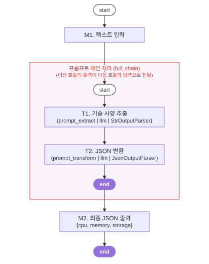
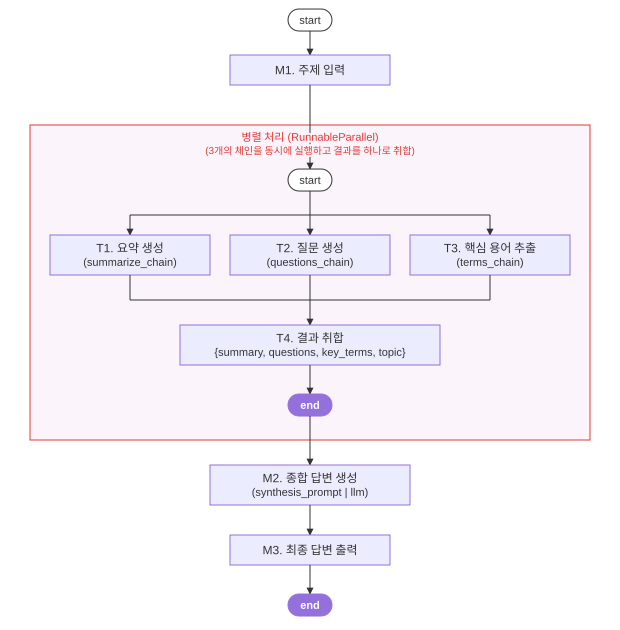
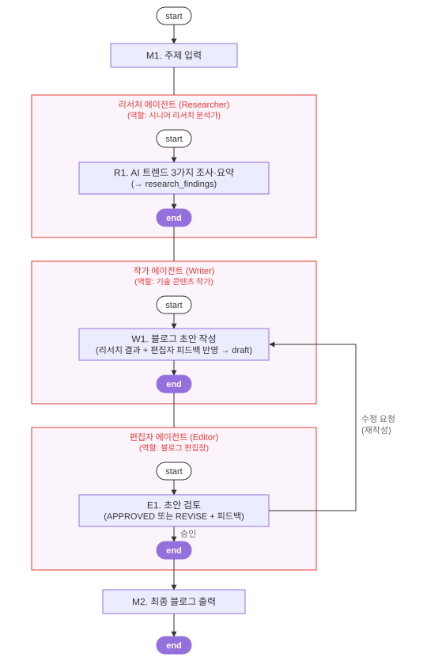
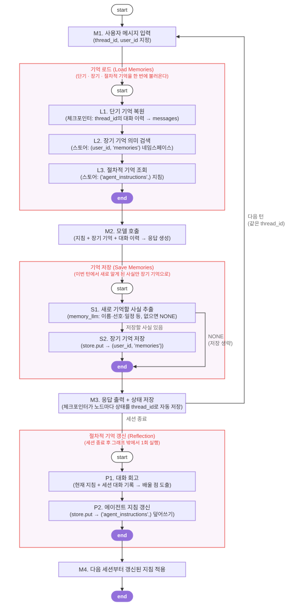
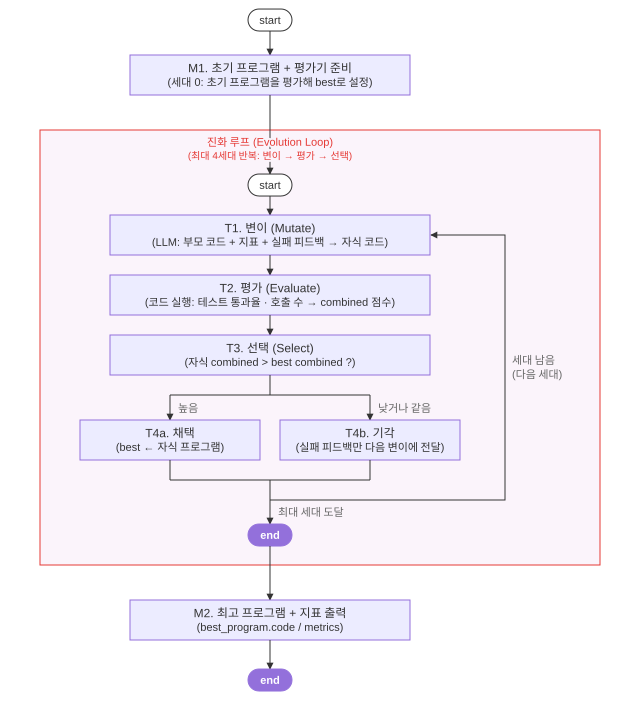
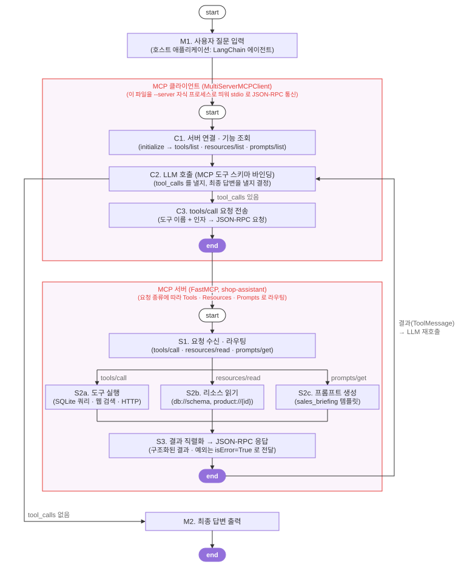
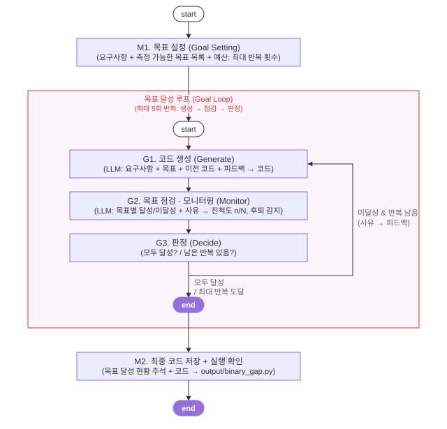

# Agentic Design Patterns

LangChain/LangGraph 기반 에이전트 디자인 패턴 학습 자료.
모든 예제는 API 키 없이 실행되는 **Fake 모델**을 사용하며, 패턴마다 동일한 표기법의 워크플로우 다이어그램이 포함되어 있습니다.

## 목차

| # | 패턴 | 한 줄 요약 | 핵심 구성 요소 | 파일 |
|:-:|------|-----------|---------------|------|
| 01 | [Prompt Chaining](#01-prompt-chaining) | 이전 LLM 호출의 출력을 다음 호출의 입력으로 순차 연결 | LCEL `\|`, `StrOutputParser`, `JsonOutputParser` | [`01-prompt-chaining.py`](01-prompt-chaining.py) |
| 02 | [Routing](#02-routing) | LLM이 의도를 분류하고 전문 핸들러로 분기 | `RunnableBranch`, `RunnablePassthrough` | [`02-routing.py`](02-routing.py) |
| 03 | [Parallelization](#03-parallelization) | 독립적인 체인을 동시에 실행하고 결과를 종합 | `RunnableParallel`, `ainvoke` | [`03-parallelization.py`](03-parallelization.py) |
| 04 | [Reflection](#04-reflection) | 생성 → 검토 → 피드백 반영을 반복해 품질 개선 | 생성자/검토자 분리, 종료 신호 `CODE_IS_PERFECT` | [`04-reflection.py`](04-reflection.py) |
| 05 | [Function Calling](#05-function-calling) | LLM이 도구 호출을 결정하고 결과를 받아 답변 | `@tool`, `create_agent`, `tool_calls` / `ToolMessage` | [`05-function-calling.py`](05-function-calling.py) |
| 06 | [Planning](#06-planning) | 계획 수립 → 단계별 실행 루프 → 종합 (Plan-and-Execute) | LangGraph `StateGraph`, `add_conditional_edges` | [`06-planning.py`](06-planning.py) |
| 07 | [Multi-Agent Collaboration](#07-multi-agent-collaboration) | 역할별 에이전트가 공유 상태로 핸드오프하며 협업 | LangGraph 노드 = 에이전트, 역할 프롬프트, 상태 키 = 전달물 | [`07-multi-agent-collaboration.py`](07-multi-agent-collaboration.py) |
| 08 | [Memory Management](#08-memory-management) | 단기(대화)·장기(사용자)·절차적(지침) 기억을 저장·검색·갱신 | `MessagesState`, `InMemorySaver`(checkpointer), `InMemoryStore`(store) | [`08-memory-management.py`](08-memory-management.py) |
| 09 | [Learning and Adaptation](#09-learning-and-adaptation) | 변이 → 실행 평가 → 선택을 반복해 코드를 진화시킴 (OpenEvolve 방식) | 평가기(`exec` + 테스트 + 호출 수), `Annotated[list, operator.add]` 아카이브, 조건부 루프 | [`09-learning-and-adaptation.py`](09-learning-and-adaptation.py) |
| 10 | [Model Context Protocol](#10-model-context-protocol) | 외부 시스템(DB·웹·파일)을 표준 프로토콜 서버로 노출하고 에이전트가 동적으로 연결 | `FastMCP` `@tool`/`@resource`/`@prompt`, `Client`, `MultiServerMCPClient` + `load_mcp_tools` | [`10-model-context-protocol.py`](10-model-context-protocol.py) |
| 11 | [Goal Setting and Monitoring](#11-goal-setting-and-monitoring) | 측정 가능한 목표 목록을 정하고, 생성 → 목표별 점검 → 판정을 반복하며 진척도를 관리 | 목표 체크리스트(`GoalStatus`), 진척도·후퇴 감지, 예산(`MAX_ITERATIONS`) 종료 조건 | [`11-goal-setting-and-monitoring.py`](11-goal-setting-and-monitoring.py) |

---

<details>
<summary><b>다이어그램 표기법</b> (펼치기)</summary>

> 워크플로우 다이어그램은 `images/` 폴더의 SVG 파일이며, 모든 패턴이 동일한 표기법을 사용합니다.

| 기호 | 의미 |
|------|------|
| `start` (흰색) / `end` (보라색) | 흐름의 시작 / 종료 |
| `M1`, `M2`, … (연보라 사각형) | 메인 흐름의 단계 (**M**ain step) |
| `T1`, `T2`, … / `B1`, `I1`, `U1`, `R1`, `W1`, `E1`, `L1`, `S1`, `P1`, `C1`, `G1` | 서브그래프 내부의 세부 단계 (**T**ask / 분기별 핸들러 / 에이전트별 작업 / 기억 **L**oad·**S**ave·**P**rocedural 갱신 / MCP **C**lient·**S**erver / **G**oal 루프) |
| 빨간 테두리 박스 (서브그래프) | 하나의 패턴 로직으로 묶이는 구간 (체인, 병렬 처리, 라우팅 분기, 반복 루프) |
| 선 위의 회색 글씨 | 분기 조건 (예: `booker` / `info` / `unclear`, `CODE_IS_PERFECT`, `tool_calls 있음`, `NONE (저장 생략)`, `세대 남음`, `tools/call`, `미달성 & 반복 남음`) |

</details>

---

## 01. Prompt Chaining

**파일:** `01-prompt-chaining.py`

여러 LLM 호출을 순차적으로 연결하여 복잡한 작업을 단계별로 처리하는 패턴.



**핵심 코드:**
```python
extraction_chain = prompt_extract | llm | StrOutputParser()
full_chain = {"specifications": extraction_chain} | prompt_transform | llm | JsonOutputParser()
```

---

## 02. Routing

**파일:** `02-routing.py`

사용자 요청을 분석하여 적절한 전문 핸들러로 분기하는 패턴.


**핵심 코드:**
```python
coordinator_agent = {
    "decision": coordinator_router_chain,  # LLM이 분류
    "request": RunnablePassthrough()       # 원본 요청 유지
} | delegation_branch                      # 분기 처리
  | (lambda x: x['output'])                # 결과 추출
```

---

## 03. Parallelization

**파일:** `03-parallelization.py`

여러 체인을 동시에 실행하여 결과를 종합하는 패턴.



**핵심 코드:**
```python
map_chain = RunnableParallel({
    "summary": summarize_chain,
    "questions": questions_chain,
    "key_terms": terms_chain,
    "topic": RunnablePassthrough()
})

full_parallel_chain = map_chain | synthesis_prompt | llm | StrOutputParser()
```

---

## 04. Reflection

**파일:** `04-reflection.py`

LLM이 생성한 결과를 스스로 검토하고 개선하는 자기 반성 패턴.


**핵심 코드:**
```python
for i in range(max_iterations):
    # 단계 1: 코드 생성
    response = llm.invoke(message_history)

    # 단계 2: 코드 검토 (리플렉션)
    critique = llm.invoke(reflector_prompt)

    if "CODE_IS_PERFECT" in critique:
        break  # 완벽하면 종료

    # 피드백 반영하여 다음 반복
    message_history.append(critique)
```

---

## 05. Function Calling

**파일:** `05-function-calling.py`

LLM이 직접 답하는 대신 "어떤 도구를 어떤 인자로 호출할지"를 결정하고, 프레임워크가 도구를 실행한 결과를 다시 LLM에 전달해 최종 답변을 만드는 패턴.


**핵심 코드:**
```python
@tool
def search_information(query: str) -> str:
    """주어진 검색어로 정보를 검색한다."""   # docstring이 LLM에 전달되는 도구 설명
    ...

agent = create_agent(model=llm, tools=[search_information], system_prompt="...")
response = agent.invoke({"messages": [HumanMessage(content=query)]})
# 내부 흐름: LLM 호출 → tool_calls 있으면 도구 실행 → ToolMessage 추가 → LLM 재호출 → 최종 답변
```

> Fake 모델이 `tool_calls`를 흉내내려면 `GenericFakeChatModel`에 `AIMessage(tool_calls=[...])`를 넣고, `bind_tools()`를 오버라이드해야 한다. (LangChain 1.0부터 `AgentExecutor` / `create_tool_calling_agent` 대신 `create_agent`를 사용)

---

## 06. Planning

**파일:** `06-planning.py`

복잡한 작업을 바로 수행하지 않고 먼저 "계획(단계 목록)"을 세운 뒤, 각 단계를 하나씩 실행하고 마지막에 결과를 종합하는 Plan-and-Execute 패턴. LangGraph의 `StateGraph`와 조건부 엣지로 실행 루프를 구성한다.


**핵심 코드:**
```python
class PlanExecuteState(TypedDict):
    topic: str; plan: list[str]; current_step: int; step_results: list[str]; final_summary: str

graph_builder = StateGraph(PlanExecuteState)
graph_builder.add_node("planner", planner_node)        # 계획 수립
graph_builder.add_node("executor", executor_node)      # 단계 실행
graph_builder.add_node("synthesizer", synthesizer_node) # 결과 종합

graph_builder.add_edge(START, "planner")
graph_builder.add_edge("planner", "executor")
graph_builder.add_conditional_edges("executor", should_continue, {
    "continue": "executor",     # 남은 단계 있음 → 루프백
    "finish": "synthesizer",    # 모든 단계 완료
})
graph_builder.add_edge("synthesizer", END)
planning_agent = graph_builder.compile()
```

---

## 07. Multi-Agent Collaboration

**파일:** `07-multi-agent-collaboration.py`

서로 다른 역할을 가진 여러 에이전트(리서처 → 작가 → 편집자)가 공유 상태를 주고받으며 하나의 결과물을 완성하는 패턴. 에이전트 하나가 LangGraph 노드 하나이며, 역할은 시스템 프롬프트로 부여하고 전달물은 상태의 키로 표현한다.



**핵심 코드:**
```python
class BlogCrewState(TypedDict):
    topic: str
    research_findings: str   # Researcher → Writer 전달물
    draft: str               # Writer → Editor 전달물
    feedback: str            # Editor → Writer 전달물 (수정 요청 시)
    revision_count: int
    final_post: str

def call_agent(role_prompt: str, content: str) -> str:   # 에이전트 = 역할 프롬프트 + 모델
    return llm.invoke([SystemMessage(content=role_prompt), HumanMessage(content=content)]).content

graph_builder.add_edge("researcher", "writer")   # 핸드오프
graph_builder.add_edge("writer", "editor")
graph_builder.add_conditional_edges("editor", route_after_editor, {
    "revise": "writer",      # 피드백과 함께 작가에게 루프백
    "approve": "finalize",
})
```

---

## 08. Memory Management

**파일:** `08-memory-management.py`

LLM은 본질적으로 상태가 없으므로, 에이전트가 맥락을 유지하려면 기억을 외부에 저장하고 다시 불러와야 한다. 한 대화 안의 메시지 이력(**단기 기억**)은 체크포인터가 `thread_id` 단위로, 세션을 넘어 남는 사용자 정보(**장기 기억**)는 스토어가 `(user_id, "memories")` 네임스페이스로 관리한다. 에이전트의 행동 지침(**절차적 기억**)도 스토어에 두고, 세션이 끝나면 회고(Reflection)로 갱신한다.



**핵심 코드:**
```python
class MemoryAgentState(MessagesState):   # messages 키는 add_messages 리듀서로 누적 (= 단기 기억)
    recalled_memories: list[str]         # 스토어에서 검색한 장기 기억
    instructions: str                    # 스토어에서 읽은 절차적 기억(지침)
    new_fact: str                        # 이번 턴에서 추출한 새 사실

store = InMemoryStore(index={"embed": fake_embed, "dims": 128})   # 임베딩을 넣으면 의미 검색 가능

def load_memories(state, config: RunnableConfig, *, store: BaseStore) -> dict:   # store는 LangGraph가 주입
    items = store.search((config["configurable"]["user_id"], "memories"), query=state["messages"][-1].content)
    instructions = store.get(("agent_instructions",), "travel_agent").value["instructions"]
    return {"recalled_memories": [i.value["content"] for i in items], "instructions": instructions}

def save_memory(state, config: RunnableConfig, *, store: BaseStore) -> None:
    store.put((config["configurable"]["user_id"], "memories"), str(uuid.uuid4()), {"content": state["new_fact"]})

memory_agent = graph_builder.compile(
    checkpointer=InMemorySaver(),   # 단기 기억: thread_id 단위로 상태 저장
    store=store,                    # 장기 기억: 노드의 store 매개변수로 주입
)
memory_agent.invoke({"messages": [HumanMessage(content=text)]},
                    config={"configurable": {"thread_id": "trip-1", "user_id": "sam"}})
```

> LangChain 0.x의 `ConversationBufferMemory` / `LLMChain`은 1.0부터 `langchain` 패키지에서 빠져 레거시 패키지(`langchain-classic`)로 분리되었다. 그 역할은 LangGraph의 체크포인터(단기)와 스토어(장기)가 대신한다. 예제는 같은 `thread_id`로 4턴(이력 누적) → 새 `thread_id`로 1턴(스토어로 이름·선호 회상) → 회고로 지침 갱신 → 새 세션 1턴(갱신된 지침 적용) 순서로 실행된다.

---

## 09. Learning and Adaptation

**파일:** `09-learning-and-adaptation.py`

에이전트가 경험(평가 결과·피드백)을 바탕으로 스스로 행동을 바꿔 성능을 높이는 패턴. 이 예제는 그중 **진화형 코딩 에이전트** 방식으로, OpenEvolve(AlphaEvolve의 오픈소스 구현)가 LLM으로 코드를 반복 최적화하는 핵심 루프를 직접 구현한다. LLM이 부모 코드·지표·실패 피드백을 보고 자식 코드를 **변이**시키고, 평가기가 코드를 **실제로 실행**해 점수를 매기며, 최고 점수보다 높을 때만 **선택**한다. Reflection(04)이 LLM의 자기 평가에 의존하는 것과 달리, 여기서는 실행 결과라는 객관적 보상으로 방향을 정한다.



**핵심 코드:**
```python
def evaluate_program(code: str) -> tuple[dict, list[str]]:      # 평가기 = 보상 함수 (코드를 실제로 실행)
    fib = load_program(code)["fib"]                              # exec()로 로드 (실서비스는 샌드박스 필수)
    for n, expected in TEST_CASES:                               # 실패한 케이스는 feedback에 기록
        ...
    correctness = passed / len(TEST_CASES)
    calls = count_calls(load_program(code)["fib"], BENCHMARK_N)  # sys.setprofile로 함수 호출 횟수 측정
    efficiency = 1 / (1 + math.log10(max(calls, 1)))             # 호출 1회면 1.0
    metrics = {"correctness": correctness, "calls": calls, "combined": round(0.7 * correctness + 0.3 * efficiency, 3)}
    return metrics, feedback

class EvolutionState(TypedDict):
    best: Program; candidate: Program; feedback: list[str]; generation: int
    history: Annotated[list[dict], operator.add]   # 세대별 기록이 누적되는 아카이브

def select_node(state):                            # 자식이 best보다 좋을 때만 교체
    accepted = state["candidate"]["metrics"]["combined"] > state["best"]["metrics"]["combined"]
    return {"best": state["candidate"] if accepted else state["best"], "history": [record]}

graph_builder.add_conditional_edges("select", should_continue, {
    "continue": "mutate",    # 세대 남음 → 다음 변이
    "finish": "report",
})
```

> 실제 OpenEvolve는 `evolve = OpenEvolve(initial_program_path, evaluation_file, config_path)` 로 만든 뒤 `await evolve.run(iterations=1000)` 으로 실행하며, 하나의 best 대신 집단(population)·섬(island) 구조로 다양성을 유지한다. 예제의 세대 4(고속 배가 알고리즘)는 점근적으로 더 빠르지만 n=22 기준 "호출 수" 지표에서는 불리해 기각되는데, 이는 **보상 설계가 진화 방향을 결정한다**는 점을 보여준다.

---

## 10. Model Context Protocol

**파일:** `10-model-context-protocol.py`

MCP는 LLM 애플리케이션(클라이언트)과 외부 시스템(서버)을 잇는 표준 프로토콜이다. 서버가 **Tools**(모델이 호출하는 동작), **Resources**(모델이 읽는 데이터), **Prompts**(재사용 템플릿) 세 가지를 MCP 규격으로 노출하면, 어떤 클라이언트든 같은 방식으로 연결해 쓸 수 있다. Function Calling(05)은 도구가 에이전트 코드 안의 파이썬 함수였지만, MCP에서는 도구가 별도 프로세스/서버에 있고 에이전트가 실행 시점에 목록을 조회해 동적으로 연결한다.

예제는 파일 하나가 서버와 클라이언트 역할을 모두 한다. FastMCP 서버가 SQLite 데이터베이스(조회 도구 + 스키마·상품 리소스), 웹 검색·HTTP 요청 도구, 로컬 파일 리소스, 프롬프트 템플릿을 노출하고, (A) FastMCP `Client`로 서버 기능을 탐색한 뒤 (B) LangChain 에이전트가 이 파일을 `--server` 자식 프로세스로 띄워 stdio로 MCP 도구를 호출한다.



**핵심 코드:**
```python
mcp = FastMCP(name="shop-assistant")                     # [서버] 세 가지 primitives 를 데코레이터로 노출

@mcp.tool
def query_database(sql: str) -> list[dict]:              # Tools: 모델이 호출 (docstring = 도구 설명)
    """쇼핑몰 SQLite 데이터베이스에 읽기 전용 SQL(SELECT)을 실행한다."""
    if not sql.strip().lower().startswith("select"):
        raise ToolError("SELECT 문만 허용됩니다.")        # → 클라이언트에 isError=True 로 전달
    return [dict(row) for row in db.execute(sql).fetchmany(20)]

@mcp.resource("db://schema")                              # Resources: 모델이 읽는 데이터
def database_schema() -> str: ...
@mcp.resource("product://{product_id}")                   # URI 템플릿 리소스
def product_detail(product_id: int) -> dict: ...
@mcp.prompt                                               # Prompts: 재사용 템플릿
def sales_briefing(month: str) -> str: ...

async with Client(mcp) as client:                         # [클라이언트 A] in-memory 연결로 프로토콜 탐색
    await client.list_tools(); await client.read_resource("db://schema")
    result = await client.call_tool("query_database", {"sql": "SELECT ..."})   # result.data = 구조화 결과

mcp_client = MultiServerMCPClient({                       # [클라이언트 B] LangChain 에이전트 ↔ stdio 서버
    "shop": {"transport": "stdio", "command": sys.executable, "args": [__file__, "--server"]},
})
async with mcp_client.session("shop") as session:
    tools = await load_mcp_tools(session)                 # tools/list → LangChain BaseTool 변환
    agent = create_agent(model=llm, tools=tools, system_prompt="...")   # 05와 동일한 에이전트 루프
    response = await agent.ainvoke({"messages": [HumanMessage(content=question)]})
```

> 실행 모드: 인자 없이 실행하면 데모(A → B), `--server`는 stdio MCP 서버(Claude Desktop 등에 등록할 때), `--http`는 `http://127.0.0.1:8000/mcp`로 서비스한다. stdio 서버에서는 표준 출력이 프로토콜 채널이므로 `print()`를 쓰면 안 된다. 버전 주의: `langchain-mcp-adapters`(0.3.x)는 `mcp<2`를 요구하므로 `fastmcp`는 3.x를 사용한다 (4.x는 `mcp>=2.3` 필요).

---

## 11. Goal Setting and Monitoring

**파일:** `11-goal-setting-and-monitoring.py`

에이전트에게 막연한 지시 대신 **측정 가능한 목표 목록**과 **예산(최대 반복 횟수)** 을 명시해 주고, 작업 중에 목표별 달성 여부를 계속 **점검(모니터링)** 해 "계속할지·수정할지·끝낼지"를 결정하는 패턴. 예제는 요구사항(Binary Gap 계산)과 목표 5개를 만족하는 파이썬 코드를 쓰는 코딩 에이전트다. 생성 LLM이 코드를 쓰면 점검 LLM이 목표 하나하나를 `달성/미달성 + 사유`로 판정하고, 코드는 이를 파싱해 진척도(n/N)와 **후퇴(regression)** 를 계산한 뒤 미달성 사유만 피드백으로 다음 생성에 넘긴다. Reflection(04)이 자유로운 비평과 "완벽하다"는 한 마디 신호에 의존하는 것과 달리, 여기서는 무엇이 되었고 무엇이 안 되었는지가 체크리스트와 수치로 남고, 종료 조건도 "모두 달성" 또는 "예산 소진" 둘뿐이라 무한히 돌지 않는다.



**핵심 코드:**
```python
GOALS = ["이해하기 쉬운 단순한 코드", "기능적으로 정확함", ...]   # [M1] 측정 가능한 목표 목록
MAX_ITERATIONS = 5                                              # [M1] 예산(제약)

class GoalStatus(TypedDict):                                    # 점검 결과를 구조화 → 진척도·후퇴·피드백에 재사용
    index: int; goal: str; met: bool; reason: str

def check_goals(code, goals) -> list[GoalStatus]:               # [G2] 점검 LLM: '번호 | 달성/미달성 | 사유' 한 줄씩
    response = monitor_llm.invoke([SystemMessage(content=MONITOR_ROLE), HumanMessage(content=request)])
    return parse_goal_report(response.content, goals)           # 응답에 빠진 목표는 보수적으로 미달성 처리

for iteration in range(1, max_iterations + 1):                  # 목표 달성 루프
    code = generate_code(use_case, goals, code, feedback)       # [G1] 이전 코드 + 피드백을 함께 전달
    previous, statuses = statuses, check_goals(code, goals)     # [G2]
    report_progress(statuses, previous)                         #      진척도 n/N + "달성 → 미달성" 후퇴 감지
    unmet = [s for s in statuses if not s["met"]]
    if not unmet or iteration == max_iterations:                # [G3] 모두 달성 / 최대 반복 도달 → 종료
        break
    feedback = build_feedback(statuses)                         #      미달성 목표 + 사유만 다음 생성에 전달
```

> 실행 결과는 진척도 `2/5 → 3/5 → 5/5`로 진행되며, 2회차에서 입력 검증·예시 출력(목표 4·5)을 추가하다가 끝의 0을 간격으로 세는 버그로 **목표 2가 달성 → 미달성으로 후퇴**하는 것을 모니터링이 잡아낸다. 최종 코드는 `output/binary_gap.py`에 목표 달성 현황 주석과 함께 저장되고 실제로 실행해 결과를 확인한다 (`output/`은 `.gitignore`에 포함). LLM이 만든 코드를 실행하므로 실제 서비스에서는 샌드박스가 필요하다.

---

## 실행 방법

```bash
# 가상환경 활성화 및 의존성 설치
source venv/bin/activate
pip install -r requirements.txt     # 10번(MCP) 예제는 fastmcp, langchain-mcp-adapters 가 추가로 필요

# 각 패턴 실행 (API 키 불필요)
python 01-prompt-chaining.py
python 02-routing.py
python 03-parallelization.py
python 04-reflection.py
python 05-function-calling.py
python 06-planning.py
python 07-multi-agent-collaboration.py
python 08-memory-management.py
python 09-learning-and-adaptation.py
python 10-model-context-protocol.py            # (--server: stdio MCP 서버만 / --http: HTTP 서버)
python 11-goal-setting-and-monitoring.py       # (output/binary_gap.py 생성)
```

---

## 패턴 비교

| 패턴 | 특징 | 사용 사례 |
|------|------|----------|
| **Prompt Chaining** | 순차 실행, 이전 결과가 다음 입력 | 다단계 변환, 정제 작업 |
| **Routing** | 조건부 분기, 전문 핸들러 위임 | 챗봇, 멀티에이전트 시스템 |
| **Parallelization** | 동시 실행, 결과 종합 | 다각도 분석, 병렬 처리 |
| **Reflection** | 자기 검토, 반복 개선 | 코드 생성, 품질 향상 |
| **Function Calling** | LLM이 도구 호출을 결정, 결과를 재전달 | 검색, API 연동, 계산 등 외부 기능 사용 |
| **Planning** | 계획 수립 → 단계별 실행 루프 → 종합 (LangGraph) | 보고서 작성, 다단계 리서치, 복잡한 작업 분해 |
| **Multi-Agent Collaboration** | 역할별 에이전트가 공유 상태로 핸드오프 (LangGraph) | 콘텐츠 제작 파이프라인, 조사-작성-검수 팀 |
| **Memory Management** | 단기(checkpointer)·장기(store)·절차적 기억을 저장·검색·갱신 (LangGraph) | 개인화 비서, 멀티세션 챗봇, 경험에서 배우는 에이전트 |
| **Learning and Adaptation** | 변이 → 실행 평가 → 선택 루프로 결과물을 진화 (LangGraph) | 코드·알고리즘 최적화, 프롬프트 자동 튜닝, 자기 개선 에이전트 |
| **Model Context Protocol** | 표준 프로토콜로 도구·리소스·프롬프트를 서버에 노출, 클라이언트가 동적 연결 (FastMCP) | DB·웹·파일 등 외부 시스템 연동, 여러 에이전트·제품이 공유하는 도구 서버 |
| **Goal Setting and Monitoring** | 측정 가능한 목표 체크리스트 + 예산을 정하고, 생성 → 목표별 점검 → 판정 루프로 진척도·후퇴를 관리 | 요구사항 기반 코드 생성, 품질 기준이 명시된 반복 작업, 장기 실행 에이전트의 진행 관리 |

