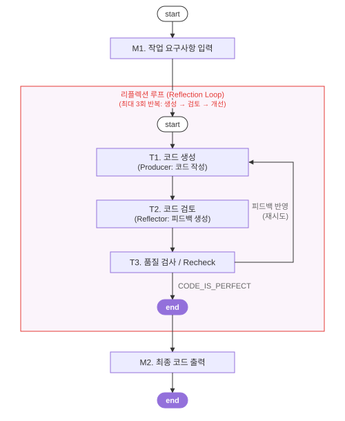
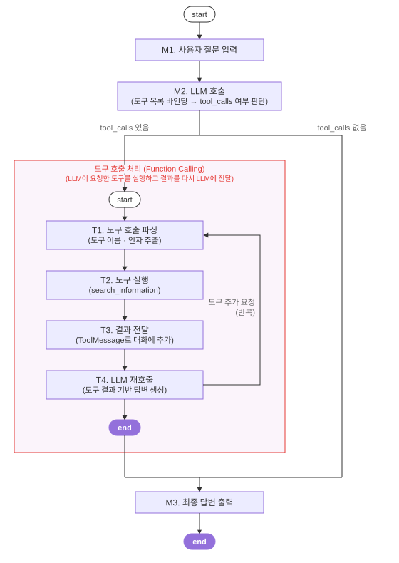
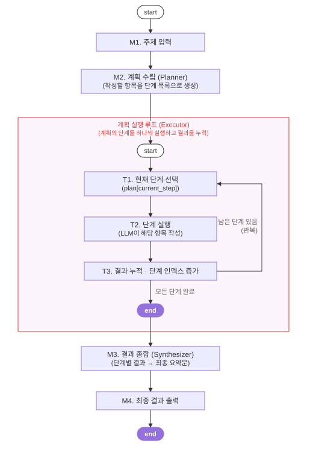

# Agentic Design Patterns

LangChain/LangGraph 기반 에이전트 디자인 패턴 학습 자료.
모든 예제는 API 키 없이 실행되는 **Fake 모델**을 사용하며, 패턴마다 동일한 표기법의 워크플로우 다이어그램이 포함되어 있습니다.

## 목차

| # | 패턴 | 한 줄 요약 | 핵심 구성 요소 | 파일 |
|:-:|------|-----------|---------------|------|
| 01 | [Prompt Chaining](#01-prompt-chaining) | 이전 LLM 호출의 출력을 다음 호출의 입력으로 순차 연결 | LCEL `\|`, `StrOutputParser`, `JsonOutputParser` | [`01-prompt-chaining.py`](01-prompt-chaining.py) |
| 02 | [Routing](#02-routing) | LLM이 의도를 분류하고 전문 핸들러로 분기 | `RunnableBranch`, `RunnablePassthrough` | [`02-routing.py`](02-routing.py) |
| 03 | [Parallelization](#03-parallelization) | 독립적인 체인을 동시에 실행하고 결과를 종합 | `RunnableParallel`, `ainvoke` | [`03-parallelization.py`](03-parallelization.py) |
| 04 | [Reflection](#04-reflection) | 생성 → 검토 → 피드백 반영을 반복해 품질 개선 | 생성자/검토자 분리, 종료 신호 `CODE_IS_PERFECT` | [`04-reflection.py`](04-reflection.py) |
| 05 | [Function Calling](#05-function-calling) | LLM이 도구 호출을 결정하고 결과를 받아 답변 | `@tool`, `create_agent`, `tool_calls` / `ToolMessage` | [`05-function-calling.py`](05-function-calling.py) |
| 06 | [Planning](#06-planning) | 계획 수립 → 단계별 실행 루프 → 종합 (Plan-and-Execute) | LangGraph `StateGraph`, `add_conditional_edges` | [`06-planning.py`](06-planning.py) |
| 07 | [Multi-Agent Collaboration](#07-multi-agent-collaboration) | 역할별 에이전트가 공유 상태로 핸드오프하며 협업 | LangGraph 노드 = 에이전트, 역할 프롬프트, 상태 키 = 전달물 | [`07-multi-agent-collaboration.py`](07-multi-agent-collaboration.py) |

---

<details>
<summary><b>다이어그램 표기법</b> (펼치기)</summary>

> 워크플로우 다이어그램은 `images/` 폴더의 SVG 파일이며, 모든 패턴이 동일한 표기법을 사용합니다.

| 기호 | 의미 |
|------|------|
| `start` (흰색) / `end` (보라색) | 흐름의 시작 / 종료 |
| `M1`, `M2`, … (연보라 사각형) | 메인 흐름의 단계 (**M**ain step) |
| `T1`, `T2`, … / `B1`, `I1`, `U1`, `R1`, `W1`, `E1` | 서브그래프 내부의 세부 단계 (**T**ask / 분기별 핸들러 / 에이전트별 작업) |
| 빨간 테두리 박스 (서브그래프) | 하나의 패턴 로직으로 묶이는 구간 (체인, 병렬 처리, 라우팅 분기, 반복 루프) |
| 선 위의 회색 글씨 | 분기 조건 (예: `booker` / `info` / `unclear`, `CODE_IS_PERFECT`, `tool_calls 있음`) |

</details>

---

## 01. Prompt Chaining

**파일:** `01-prompt-chaining.py`

여러 LLM 호출을 순차적으로 연결하여 복잡한 작업을 단계별로 처리하는 패턴.


**핵심 코드:**
```python
extraction_chain = prompt_extract | llm | StrOutputParser()
full_chain = {"specifications": extraction_chain} | prompt_transform | llm | JsonOutputParser()
```

---

## 02. Routing

**파일:** `02-routing.py`

사용자 요청을 분석하여 적절한 전문 핸들러로 분기하는 패턴.


**핵심 코드:**
```python
coordinator_agent = {
    "decision": coordinator_router_chain,  # LLM이 분류
    "request": RunnablePassthrough()       # 원본 요청 유지
} | delegation_branch                      # 분기 처리
  | (lambda x: x['output'])                # 결과 추출
```

---

## 03. Parallelization

**파일:** `03-parallelization.py`

여러 체인을 동시에 실행하여 결과를 종합하는 패턴.


**핵심 코드:**
```python
map_chain = RunnableParallel({
    "summary": summarize_chain,
    "questions": questions_chain,
    "key_terms": terms_chain,
    "topic": RunnablePassthrough()
})

full_parallel_chain = map_chain | synthesis_prompt | llm | StrOutputParser()
```

---

## 04. Reflection

**파일:** `04-reflection.py`

LLM이 생성한 결과를 스스로 검토하고 개선하는 자기 반성 패턴.



**핵심 코드:**
```python
for i in range(max_iterations):
    # 단계 1: 코드 생성
    response = llm.invoke(message_history)

    # 단계 2: 코드 검토 (리플렉션)
    critique = llm.invoke(reflector_prompt)

    if "CODE_IS_PERFECT" in critique:
        break  # 완벽하면 종료

    # 피드백 반영하여 다음 반복
    message_history.append(critique)
```

---

## 05. Function Calling

**파일:** `05-function-calling.py`

LLM이 직접 답하는 대신 "어떤 도구를 어떤 인자로 호출할지"를 결정하고, 프레임워크가 도구를 실행한 결과를 다시 LLM에 전달해 최종 답변을 만드는 패턴.



**핵심 코드:**
```python
@tool
def search_information(query: str) -> str:
    """주어진 검색어로 정보를 검색한다."""   # docstring이 LLM에 전달되는 도구 설명
    ...

agent = create_agent(model=llm, tools=[search_information], system_prompt="...")
response = agent.invoke({"messages": [HumanMessage(content=query)]})
# 내부 흐름: LLM 호출 → tool_calls 있으면 도구 실행 → ToolMessage 추가 → LLM 재호출 → 최종 답변
```

> Fake 모델이 `tool_calls`를 흉내내려면 `GenericFakeChatModel`에 `AIMessage(tool_calls=[...])`를 넣고, `bind_tools()`를 오버라이드해야 한다. (LangChain 1.0부터 `AgentExecutor` / `create_tool_calling_agent` 대신 `create_agent`를 사용)

---

## 06. Planning

**파일:** `06-planning.py`

복잡한 작업을 바로 수행하지 않고 먼저 "계획(단계 목록)"을 세운 뒤, 각 단계를 하나씩 실행하고 마지막에 결과를 종합하는 Plan-and-Execute 패턴. LangGraph의 `StateGraph`와 조건부 엣지로 실행 루프를 구성한다.



**핵심 코드:**
```python
class PlanExecuteState(TypedDict):
    topic: str; plan: list[str]; current_step: int; step_results: list[str]; final_summary: str

graph_builder = StateGraph(PlanExecuteState)
graph_builder.add_node("planner", planner_node)        # 계획 수립
graph_builder.add_node("executor", executor_node)      # 단계 실행
graph_builder.add_node("synthesizer", synthesizer_node) # 결과 종합

graph_builder.add_edge(START, "planner")
graph_builder.add_edge("planner", "executor")
graph_builder.add_conditional_edges("executor", should_continue, {
    "continue": "executor",     # 남은 단계 있음 → 루프백
    "finish": "synthesizer",    # 모든 단계 완료
})
graph_builder.add_edge("synthesizer", END)
planning_agent = graph_builder.compile()
```

---

## 07. Multi-Agent Collaboration

**파일:** `07-multi-agent-collaboration.py`

서로 다른 역할을 가진 여러 에이전트(리서처 → 작가 → 편집자)가 공유 상태를 주고받으며 하나의 결과물을 완성하는 패턴. 에이전트 하나가 LangGraph 노드 하나이며, 역할은 시스템 프롬프트로 부여하고 전달물은 상태의 키로 표현한다.


**핵심 코드:**
```python
class BlogCrewState(TypedDict):
    topic: str
    research_findings: str   # Researcher → Writer 전달물
    draft: str               # Writer → Editor 전달물
    feedback: str            # Editor → Writer 전달물 (수정 요청 시)
    revision_count: int
    final_post: str

def call_agent(role_prompt: str, content: str) -> str:   # 에이전트 = 역할 프롬프트 + 모델
    return llm.invoke([SystemMessage(content=role_prompt), HumanMessage(content=content)]).content

graph_builder.add_edge("researcher", "writer")   # 핸드오프
graph_builder.add_edge("writer", "editor")
graph_builder.add_conditional_edges("editor", route_after_editor, {
    "revise": "writer",      # 피드백과 함께 작가에게 루프백
    "approve": "finalize",
})
```

---

## 실행 방법

```bash
# 가상환경 활성화
source venv/bin/activate

# 각 패턴 실행
python 01-prompt-chaining.py
python 02-routing.py
python 03-parallelization.py
python 04-reflection.py
python 05-function-calling.py
python 06-planning.py
python 07-multi-agent-collaboration.py
```

---

## 패턴 비교

| 패턴 | 특징 | 사용 사례 |
|------|------|----------|
| **Prompt Chaining** | 순차 실행, 이전 결과가 다음 입력 | 다단계 변환, 정제 작업 |
| **Routing** | 조건부 분기, 전문 핸들러 위임 | 챗봇, 멀티에이전트 시스템 |
| **Parallelization** | 동시 실행, 결과 종합 | 다각도 분석, 병렬 처리 |
| **Reflection** | 자기 검토, 반복 개선 | 코드 생성, 품질 향상 |
| **Function Calling** | LLM이 도구 호출을 결정, 결과를 재전달 | 검색, API 연동, 계산 등 외부 기능 사용 |
| **Planning** | 계획 수립 → 단계별 실행 루프 → 종합 (LangGraph) | 보고서 작성, 다단계 리서치, 복잡한 작업 분해 |
| **Multi-Agent Collaboration** | 역할별 에이전트가 공유 상태로 핸드오프 (LangGraph) | 콘텐츠 제작 파이프라인, 조사-작성-검수 팀 |

