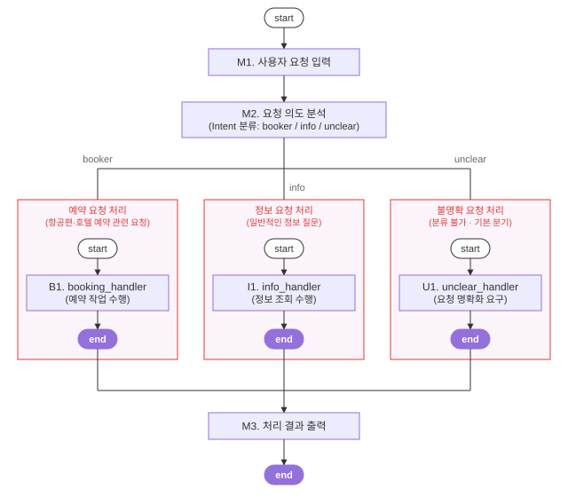
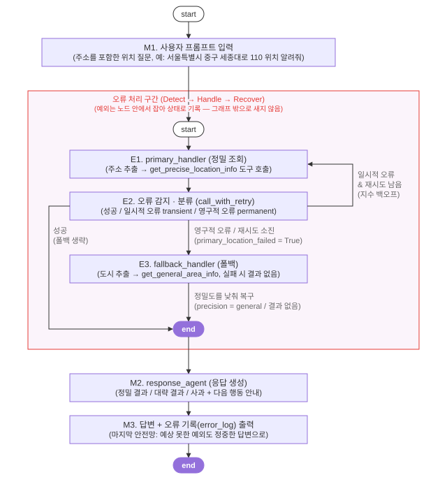
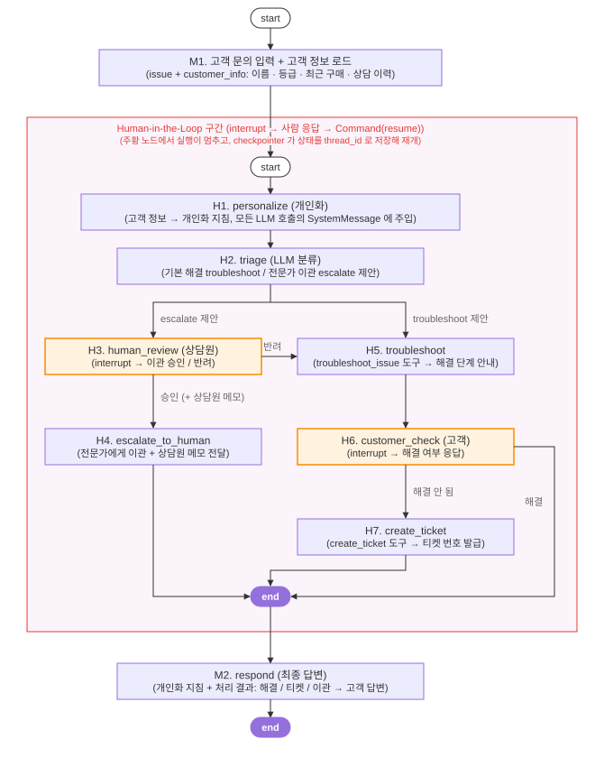
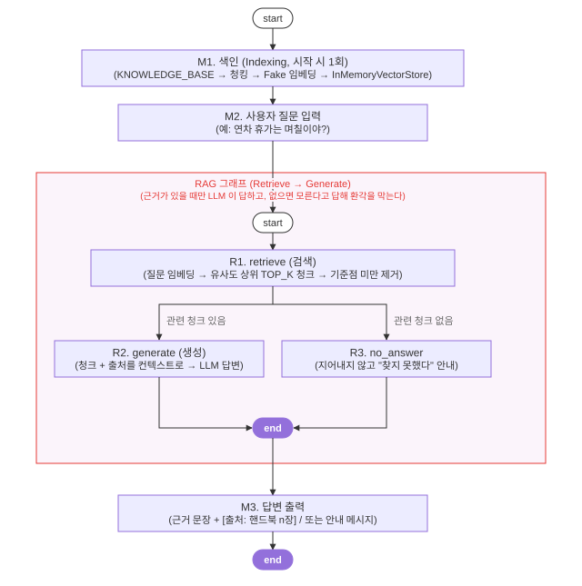
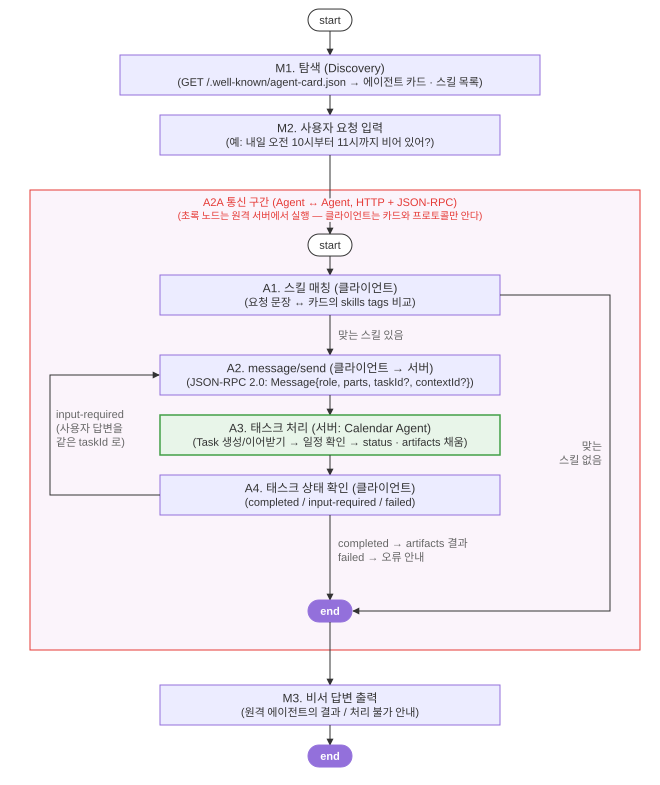

# Agentic Design Patterns

LangChain/LangGraph 기반 에이전트 디자인 패턴 학습 자료.

- 모든 예제는 API 키 없이 실행되는 **Fake 모델**을 사용합니다.
- 패턴마다 같은 표기법의 워크플로우 다이어그램이 있습니다.
- 모든 소스 파일은 같은 구조(설정 · 상수 → 상태 → 도구 → 모델 → 노드 → 그래프 → 실행)로 작성되어 있습니다.

## 목차

| # | 패턴 | 한 줄 요약 | 핵심 구성 요소 | 파일 |
|:-:|------|-----------|---------------|------|
| 01 | [Prompt Chaining](#01-prompt-chaining) | 이전 LLM 호출의 출력을 다음 호출의 입력으로 순차 연결 | LCEL `\|`, `StrOutputParser`, `JsonOutputParser` | [`01-prompt-chaining.py`](01-prompt-chaining.py) |
| 02 | [Routing](#02-routing) | LLM이 의도를 분류하고 전문 핸들러로 분기 | `RunnableBranch`, `RunnablePassthrough` | [`02-routing.py`](02-routing.py) |
| 03 | [Parallelization](#03-parallelization) | 독립적인 체인을 동시에 실행하고 결과를 종합 | `RunnableParallel`, `ainvoke` | [`03-parallelization.py`](03-parallelization.py) |
| 04 | [Reflection](#04-reflection) | 생성 → 검토 → 피드백 반영을 반복해 품질 개선 | 생성자/검토자 분리, 종료 신호 `CODE_IS_PERFECT` | [`04-reflection.py`](04-reflection.py) |
| 05 | [Function Calling](#05-function-calling) | LLM이 도구 호출을 결정하고 결과를 받아 답변 | `@tool`, `create_agent`, `tool_calls` / `ToolMessage` | [`05-function-calling.py`](05-function-calling.py) |
| 06 | [Planning](#06-planning) | 계획 수립 → 단계별 실행 루프 → 종합 (Plan-and-Execute) | LangGraph `StateGraph`, `add_conditional_edges` | [`06-planning.py`](06-planning.py) |
| 07 | [Multi-Agent Collaboration](#07-multi-agent-collaboration) | 역할별 에이전트가 공유 상태로 핸드오프하며 협업 | LangGraph 노드 = 에이전트, 역할 프롬프트, 상태 키 = 전달물 | [`07-multi-agent-collaboration.py`](07-multi-agent-collaboration.py) |
| 08 | [Memory Management](#08-memory-management) | 단기(대화)·장기(사용자)·절차적(지침) 기억을 저장·검색·갱신 | `MessagesState`, `InMemorySaver`(checkpointer), `InMemoryStore`(store) | [`08-memory-management.py`](08-memory-management.py) |
| 09 | [Learning and Adaptation](#09-learning-and-adaptation) | 변이 → 실행 평가 → 선택을 반복해 코드를 진화시킴 (OpenEvolve 방식) | 평가기(`exec` + 테스트 + 호출 수), `Annotated[list, operator.add]` 아카이브, 조건부 루프 | [`09-learning-and-adaptation.py`](09-learning-and-adaptation.py) |
| 10 | [Model Context Protocol](#10-model-context-protocol) | 외부 시스템(DB·웹·파일)을 표준 프로토콜 서버로 노출하고 에이전트가 동적으로 연결 | `FastMCP` `@tool`/`@resource`/`@prompt`, `Client`, `MultiServerMCPClient` + `load_mcp_tools` | [`10-model-context-protocol.py`](10-model-context-protocol.py) |
| 11 | [Goal Setting and Monitoring](#11-goal-setting-and-monitoring) | 측정 가능한 목표 목록을 정하고, 생성 → 목표별 점검 → 판정을 반복하며 진척도를 관리 | 목표 체크리스트(`GoalStatus`), 진척도·후퇴 감지, 예산(`MAX_ITERATIONS`) 종료 조건 | [`11-goal-setting-and-monitoring.py`](11-goal-setting-and-monitoring.py) |
| 12 | [Exception Handling and Recovery](#12-exception-handling-and-recovery) | 도구 예외를 분류해 재시도·폴백으로 복구하고, 모두 실패해도 정중하게 응답 | 오류 분류(`transient`/`permanent`), 지수 백오프 재시도, 조건부 폴백 노드, `error_log` 누적 | [`12-exception-handling-and-recovery.py`](12-exception-handling-and-recovery.py) |
| 13 | [Human-in-the-Loop](#13-human-in-the-loop) | 중요한 결정 앞에서 실행을 멈추고 사람의 승인·응답을 받아 이어서 진행 | `interrupt()` / `Command(resume=...)`, `InMemorySaver`(checkpointer), 개인화 지침 주입 | [`13-human-in-the-loop.py`](13-human-in-the-loop.py) |
| 14 | [Knowledge Retrieval (RAG)](#14-knowledge-retrieval-rag) | 질문과 관련된 문서를 검색해 그 내용만 근거로 답변 | `RecursiveCharacterTextSplitter`, `InMemoryVectorStore`, 유사도 기준점 + `no_answer` 분기 | [`14-knowledge-retrieval-rag.py`](14-knowledge-retrieval-rag.py) |
| 15 | [Inter-Agent Communication (A2A)](#15-inter-agent-communication-a2a) | 서로 다른 서버의 에이전트가 표준 프로토콜(A2A)로 일을 맡기고 결과를 받음 | 에이전트 카드(Discovery), JSON-RPC `message/send`, 태스크 상태(`input-required`) | [`15-inter-agent-communication-a2a.py`](15-inter-agent-communication-a2a.py) |

---

<details>
<summary><b>다이어그램 표기법</b> (펼치기)</summary>

> 워크플로우 다이어그램은 `images/` 폴더의 SVG 파일이며, 모든 패턴이 동일한 표기법을 사용합니다.

| 기호 | 의미 |
|------|------|
| `start` (흰색) / `end` (보라색) | 흐름의 시작 / 종료 |
| `M1`, `M2`, … (연보라 사각형) | 메인 흐름의 단계 (**M**ain step) |
| `T1`, `T2`, … / `B1`, `I1`, `U1`, `R1`, `W1`, `E1`, `L1`, `S1`, `P1`, `C1`, `G1` | 서브그래프 내부의 세부 단계 (**T**ask / 분기별 핸들러 / 에이전트별 작업 / 기억 **L**oad·**S**ave·**P**rocedural 갱신 / MCP **C**lient·**S**erver / **G**oal 루프 / **E**rror 처리 구간 / **H**uman-in-the-Loop 구간 / **R**AG 그래프 / **A**2A 통신) |
| 주황 사각형 | 사람이 개입하는 단계 — 여기서 실행이 멈추고(`interrupt`) 사람의 응답으로 재개 (13번) |
| 초록 사각형 | 원격 서버(다른 에이전트)에서 실행되는 단계 (15번) |
| 빨간 테두리 박스 (서브그래프) | 하나의 패턴 로직으로 묶이는 구간 (체인, 병렬 처리, 라우팅 분기, 반복 루프) |
| 선 위의 회색 글씨 | 분기 조건 (예: `booker` / `info` / `unclear`, `CODE_IS_PERFECT`, `tool_calls 있음`, `NONE (저장 생략)`, `세대 남음`, `tools/call`, `미달성 & 반복 남음`, `일시적 오류 & 재시도 남음`, `승인` / `반려`, `관련 청크 있음` / `없음`, `input-required`) |

</details>

---

## 01. Prompt Chaining

**파일:** `01-prompt-chaining.py`

- 큰 작업을 여러 개의 작은 LLM 호출로 쪼갠다.
- 이전 호출의 출력을 다음 호출의 입력으로 순서대로 연결한다.
- 예제는 텍스트에서 기술 사양을 추출한 뒤 JSON으로 변환한다.
- 단계마다 프롬프트가 단순해져 결과가 안정적이다.


**핵심 코드:**
```python
extraction_chain = prompt_extract | llm | StrOutputParser()

full_chain = (
    {"specifications": extraction_chain}   # 체인 1의 출력을 체인 2의 입력 변수로 전달
    | prompt_transform
    | llm
    | JsonOutputParser()
)
```

---

## 02. Routing

**파일:** `02-routing.py`

- LLM이 사용자 요청의 의도를 먼저 분류한다.
- 분류 결과에 따라 알맞은 전문 핸들러로 요청을 보낸다.
- 분류할 수 없는 요청은 기본 핸들러가 처리한다.



**핵심 코드:**
```python
coordinator_agent = (
    {
        "decision": coordinator_router_chain,   # LLM이 분류
        "request": RunnablePassthrough(),       # 원본 요청 유지
    }
    | delegation_branch                         # 분기 처리
    | (lambda x: x["output"])                   # 결과 추출
)
```

---

## 03. Parallelization

**파일:** `03-parallelization.py`

- 서로 독립적인 체인 여러 개를 동시에 실행한다.
- 요약 · 질문 생성 · 핵심 용어 추출을 한 번에 돌린다.
- 마지막에 병렬 결과를 하나의 응답으로 종합한다.
- 순차 실행보다 전체 대기 시간이 짧다.


**핵심 코드:**
```python
map_chain = RunnableParallel({
    "summary": summarize_chain,
    "questions": questions_chain,
    "key_terms": terms_chain,
    "topic": RunnablePassthrough(),
})

full_parallel_chain = map_chain | synthesis_prompt | llm | StrOutputParser()
```

---

## 04. Reflection

**파일:** `04-reflection.py`

- 생성자가 코드를 만들고, 검토자가 그 코드를 비평한다.
- 비평을 피드백으로 넘겨 다시 생성하는 과정을 반복한다.
- 검토자가 `CODE_IS_PERFECT` 신호를 보내면 반복을 멈춘다.


**핵심 코드:**
```python
for i in range(MAX_ITERATIONS):
    # 단계 1: 코드 생성
    response = llm.invoke(message_history)

    # 단계 2: 코드 검토 (리플렉션)
    critique = llm.invoke(reflector_prompt)

    if "CODE_IS_PERFECT" in critique:
        break  # 완벽하면 종료

    # 피드백 반영하여 다음 반복
    message_history.append(critique)
```

---

## 05. Function Calling

**파일:** `05-function-calling.py`

- LLM이 직접 답하지 않고 "어떤 도구를 어떤 인자로 부를지"를 결정한다.
- 프레임워크가 도구를 실행하고 결과를 다시 LLM에 전달한다.
- LLM은 도구 결과를 보고 최종 답변을 만든다.
- 도구의 docstring이 LLM에게 전달되는 도구 설명이 된다.


**핵심 코드:**
```python
@tool
def search_information(query: str) -> str:
    """주어진 검색어로 정보를 검색한다."""   # docstring이 LLM에 전달되는 도구 설명
    ...

agent = create_agent(
    model=llm,
    tools=[search_information],
    system_prompt="...",
)

# 내부 흐름: LLM 호출 → tool_calls 있으면 도구 실행 → ToolMessage 추가 → LLM 재호출 → 최종 답변
response = agent.invoke({"messages": [HumanMessage(content=query)]})
```

**참고:**
- Fake 모델로 `tool_calls`를 흉내내려면 `GenericFakeChatModel`에 `AIMessage(tool_calls=[...])`를 넣는다.
- 이때 `bind_tools()`를 오버라이드해야 에이전트가 도구를 바인딩할 수 있다.
- LangChain 1.0부터는 `AgentExecutor` 대신 `create_agent`를 사용한다.

---

## 06. Planning

**파일:** `06-planning.py`

- 작업을 바로 수행하지 않고 먼저 계획(단계 목록)을 세운다.
- 계획의 각 단계를 하나씩 실행하는 루프를 돈다.
- 모든 단계가 끝나면 결과를 하나로 종합한다. (Plan-and-Execute)
- LangGraph의 `StateGraph`와 조건부 엣지로 실행 루프를 만든다.


**핵심 코드:**
```python
class PlanExecuteState(TypedDict):
    topic: str
    plan: list[str]
    current_step: int
    step_results: list[str]
    final_summary: str

graph_builder = StateGraph(PlanExecuteState)
graph_builder.add_node("planner", planner_node)          # 계획 수립
graph_builder.add_node("executor", executor_node)        # 단계 실행
graph_builder.add_node("synthesizer", synthesizer_node)  # 결과 종합

graph_builder.add_edge(START, "planner")
graph_builder.add_edge("planner", "executor")
graph_builder.add_conditional_edges(
    "executor",
    should_continue,
    {
        "continue": "executor",     # 남은 단계 있음 → 루프백
        "finish": "synthesizer",    # 모든 단계 완료
    },
)
graph_builder.add_edge("synthesizer", END)

planning_agent = graph_builder.compile()
```

---

## 07. Multi-Agent Collaboration

**파일:** `07-multi-agent-collaboration.py`

- 역할이 다른 에이전트(리서처 → 작가 → 편집자)가 함께 결과물을 만든다.
- 에이전트 하나가 LangGraph 노드 하나이고, 역할은 시스템 프롬프트로 준다.
- 에이전트 사이의 전달물은 공유 상태의 키로 표현한다.
- 편집자가 수정을 요청하면 피드백과 함께 작가에게 되돌린다.


**핵심 코드:**
```python
class BlogCrewState(TypedDict):
    topic: str
    research_findings: str   # Researcher → Writer 전달물
    draft: str               # Writer → Editor 전달물
    feedback: str            # Editor → Writer 전달물 (수정 요청 시)
    revision_count: int
    final_post: str

def call_agent(role_prompt: str, content: str) -> str:   # 에이전트 = 역할 프롬프트 + 모델
    response = llm.invoke([
        SystemMessage(content=role_prompt),
        HumanMessage(content=content),
    ])
    return response.content

graph_builder.add_edge("researcher", "writer")   # 핸드오프
graph_builder.add_edge("writer", "editor")
graph_builder.add_conditional_edges(
    "editor",
    route_after_editor,
    {
        "revise": "writer",      # 피드백과 함께 작가에게 루프백
        "approve": "finalize",
    },
)
```

---

## 08. Memory Management

**파일:** `08-memory-management.py`

- LLM은 상태가 없으므로 기억을 외부에 저장하고 다시 불러와야 한다.
- **단기 기억**: 한 대화의 메시지 이력이며, 체크포인터가 `thread_id` 단위로 저장한다.
- **장기 기억**: 세션을 넘어 남는 사용자 정보이며, 스토어가 `(user_id, "memories")`에 저장한다.
- **절차적 기억**: 에이전트의 행동 지침이며, 세션이 끝나면 회고(Reflection)로 갱신한다.


**핵심 코드:**
```python
class MemoryAgentState(MessagesState):   # messages 키는 add_messages 리듀서로 누적 (= 단기 기억)
    recalled_memories: list[str]         # 스토어에서 검색한 장기 기억
    instructions: str                    # 스토어에서 읽은 절차적 기억(지침)
    new_fact: str                        # 이번 턴에서 추출한 새 사실

store = InMemoryStore(index={"embed": fake_embed, "dims": 128})   # 임베딩을 넣으면 의미 검색 가능

def load_memories(state, config: RunnableConfig, *, store: BaseStore) -> dict:   # store는 LangGraph가 주입
    user_id = config["configurable"]["user_id"]
    items = store.search(
        (user_id, "memories"),
        query=state["messages"][-1].content,
    )
    instructions = store.get(("agent_instructions",), "travel_agent").value["instructions"]
    return {
        "recalled_memories": [item.value["content"] for item in items],
        "instructions": instructions,
    }

memory_agent = graph_builder.compile(
    checkpointer=InMemorySaver(),   # 단기 기억: thread_id 단위로 상태 저장
    store=store,                    # 장기 기억: 노드의 store 매개변수로 주입
)

memory_agent.invoke(
    {"messages": [HumanMessage(content=text)]},
    config={"configurable": {"thread_id": "trip-1", "user_id": "sam"}},
)
```

**참고:**
- LangChain 0.x의 `ConversationBufferMemory`는 1.0부터 레거시 패키지(`langchain-classic`)로 분리되었다.
- 그 역할은 LangGraph의 체크포인터(단기)와 스토어(장기)가 대신한다.
- 실행 순서: 같은 `thread_id`로 4턴 → 새 `thread_id`로 1턴(이름·선호 회상) → 회고로 지침 갱신 → 새 세션 1턴.

---

## 09. Learning and Adaptation

**파일:** `09-learning-and-adaptation.py`

- 에이전트가 평가 결과를 바탕으로 스스로 결과물을 개선한다.
- OpenEvolve(AlphaEvolve의 오픈소스 구현) 방식의 진화형 코딩 에이전트를 직접 구현한다.
- **변이**: LLM이 부모 코드 · 지표 · 실패 피드백을 보고 자식 코드를 만든다.
- **평가**: 평가기가 코드를 실제로 실행해 점수를 매긴다.
- **선택**: 최고 점수보다 높을 때만 자식 코드를 채택한다.
- Reflection(04)과 달리 LLM의 자기 평가가 아닌 실행 결과로 방향을 정한다.


**핵심 코드:**
```python
def evaluate_program(code: str) -> tuple[dict, list[str]]:      # 평가기 = 보상 함수 (코드를 실제로 실행)
    fib = load_program(code)["fib"]                              # exec()로 로드 (실서비스는 샌드박스 필수)
    for n, expected in TEST_CASES:                               # 실패한 케이스는 feedback에 기록
        ...

    correctness = passed / len(TEST_CASES)
    calls = count_calls(load_program(code)["fib"], BENCHMARK_N)  # sys.setprofile로 함수 호출 횟수 측정
    efficiency = 1 / (1 + math.log10(max(calls, 1)))             # 호출 1회면 1.0
    combined = round(0.7 * correctness + 0.3 * efficiency, 3)

    metrics = {"correctness": correctness, "calls": calls, "combined": combined}
    return metrics, feedback

class EvolutionState(TypedDict):
    best: Program
    candidate: Program
    feedback: list[str]
    generation: int
    history: Annotated[list[dict], operator.add]   # 세대별 기록이 누적되는 아카이브

def select_node(state):                            # 자식이 best보다 좋을 때만 교체
    accepted = state["candidate"]["metrics"]["combined"] > state["best"]["metrics"]["combined"]
    ...

graph_builder.add_conditional_edges(
    "select",
    should_continue,
    {
        "continue": "mutate",    # 세대 남음 → 다음 변이
        "finish": "report",
    },
)
```

**참고:**
- 실제 OpenEvolve는 `OpenEvolve(initial_program_path, evaluation_file, config_path)`로 만들고 `await evolve.run(...)`으로 실행한다.
- 실제 OpenEvolve는 best 하나 대신 집단(population)·섬(island) 구조로 다양성을 유지한다.
- 예제의 세대 4(고속 배가 알고리즘)는 더 빠르지만 "호출 수" 지표에서 불리해 기각된다.
- 즉, **보상 설계가 진화 방향을 결정한다.**

---

## 10. Model Context Protocol

**파일:** `10-model-context-protocol.py`

- MCP는 LLM 애플리케이션(클라이언트)과 외부 시스템(서버)을 잇는 표준 프로토콜이다.
- 서버는 **Tools**(호출할 동작) · **Resources**(읽을 데이터) · **Prompts**(재사용 템플릿)를 노출한다.
- 어떤 클라이언트든 같은 방식으로 서버에 연결해 기능을 쓸 수 있다.
- Function Calling(05)과 달리 도구가 별도 서버에 있고, 에이전트가 실행 시점에 동적으로 연결한다.
- 예제의 서버는 SQLite DB · 웹 검색 · 로컬 파일 · 프롬프트 템플릿을 노출한다.
- (A) FastMCP `Client`로 서버 기능을 탐색하고, (B) LangChain 에이전트가 stdio로 도구를 호출한다.


**핵심 코드:**
```python
mcp = FastMCP(name="shop-assistant")                     # [서버] 세 가지 primitives 를 데코레이터로 노출

@mcp.tool
def query_database(sql: str) -> list[dict]:              # Tools: 모델이 호출 (docstring = 도구 설명)
    """쇼핑몰 SQLite 데이터베이스에 읽기 전용 SQL(SELECT)을 실행한다."""
    if not sql.strip().lower().startswith("select"):
        raise ToolError("SELECT 문만 허용됩니다.")        # → 클라이언트에 isError=True 로 전달
    return [dict(row) for row in db.execute(sql).fetchmany(20)]

@mcp.resource("db://schema")                              # Resources: 모델이 읽는 데이터
def database_schema() -> str: ...

@mcp.resource("product://{product_id}")                   # URI 템플릿 리소스
def product_detail(product_id: int) -> dict: ...

@mcp.prompt                                               # Prompts: 재사용 템플릿
def sales_briefing(month: str) -> str: ...

async with Client(mcp) as client:                         # [클라이언트 A] in-memory 연결로 프로토콜 탐색
    await client.list_tools()
    await client.read_resource("db://schema")
    result = await client.call_tool(
        "query_database",
        {"sql": "SELECT ..."},
    )                                                     # result.data = 구조화 결과

mcp_client = MultiServerMCPClient({                       # [클라이언트 B] LangChain 에이전트 ↔ stdio 서버
    "shop": {
        "transport": "stdio",
        "command": sys.executable,
        "args": [__file__, "--server"],
    },
})
async with mcp_client.session("shop") as session:
    tools = await load_mcp_tools(session)                 # tools/list → LangChain BaseTool 변환
    agent = create_agent(model=llm, tools=tools, system_prompt="...")   # 05와 동일한 에이전트 루프
    response = await agent.ainvoke({"messages": [HumanMessage(content=USER_QUESTION)]})
```

**참고:**
- 인자 없이 실행하면 데모(A → B)가 돌아간다.
- `--server`는 stdio MCP 서버로 실행한다. (Claude Desktop 등에 등록할 때)
- `--http`는 `http://127.0.0.1:8000/mcp`로 서비스한다.
- stdio 서버에서는 표준 출력이 프로토콜 채널이므로 `print()`를 쓰면 안 된다.
- `langchain-mcp-adapters`(0.3.x)가 `mcp<2`를 요구하므로 `fastmcp`는 3.x를 쓴다.

---

## 11. Goal Setting and Monitoring

**파일:** `11-goal-setting-and-monitoring.py`

- 막연한 지시 대신 **측정 가능한 목표 목록**과 **예산(최대 반복 횟수)** 을 준다.
- 작업 중에 목표별 달성 여부를 계속 **점검(모니터링)** 한다.
- 점검 결과로 진척도(n/N)와 **후퇴(regression)** 를 계산한다.
- 미달성 목표와 사유만 피드백으로 다음 생성에 넘긴다.
- 종료 조건은 "모두 달성" 또는 "예산 소진" 둘뿐이라 무한히 돌지 않는다.
- 예제는 Binary Gap 계산 코드를 목표 5개에 맞춰 작성하는 코딩 에이전트다.


**핵심 코드:**
```python
GOALS = ["이해하기 쉬운 단순한 코드", "기능적으로 정확함", ...]   # [M1] 측정 가능한 목표 목록
MAX_ITERATIONS = 5                                              # [M1] 예산(제약)

class GoalStatus(TypedDict):    # 점검 결과를 구조화 → 진척도·후퇴·피드백에 재사용
    index: int
    goal: str
    met: bool
    reason: str

def check_goals(code, goals) -> list[GoalStatus]:     # [G2] 점검 LLM: '번호 | 달성/미달성 | 사유' 한 줄씩
    response = monitor_llm.invoke([
        SystemMessage(content=MONITOR_ROLE),
        HumanMessage(content=request),
    ])
    return parse_goal_report(response.content, goals) # 응답에 빠진 목표는 보수적으로 미달성 처리

for iteration in range(1, max_iterations + 1):        # 목표 달성 루프
    code = generate_code(use_case, goals, code, feedback)   # [G1] 이전 코드 + 피드백을 함께 전달

    previous = statuses
    statuses = check_goals(code, goals)               # [G2]
    report_progress(statuses, previous)               #      진척도 n/N + "달성 → 미달성" 후퇴 감지

    unmet = [s for s in statuses if not s["met"]]
    if not unmet or iteration == max_iterations:      # [G3] 모두 달성 / 최대 반복 도달 → 종료
        break

    feedback = build_feedback(statuses)               #      미달성 목표 + 사유만 다음 생성에 전달
```

**참고:**
- 진척도는 `2/5 → 3/5 → 5/5`로 진행된다.
- 2회차에서 버그가 생겨 **목표 2가 달성 → 미달성으로 후퇴**하는 것을 모니터링이 잡아낸다.
- 최종 코드는 `output/binary_gap.py`에 저장되고 실제로 실행해 확인한다. (`output/`은 `.gitignore`에 포함)
- LLM이 만든 코드를 실행하므로 실제 서비스에서는 샌드박스가 필요하다.

---

## 12. Exception Handling and Recovery

**파일:** `12-exception-handling-and-recovery.py`

- 도구(외부 API)는 타임아웃 · 서버 장애 · 잘못된 입력 등으로 언제든 실패한다.
- 실패를 "프로그램이 죽는 사건"이 아니라 "에이전트가 다룰 상태"로 본다.
- **일시적 오류**(`TimeoutError`, `ConnectionError`)는 지수 백오프로 재시도한다.
- **영구적 오류**(`LookupError`, `ValueError`)는 재시도 없이 바로 폴백한다.
- 정밀 조회가 실패하면 폴백 노드가 도시 단위의 대략적인 정보를 찾는다.
- 결과는 정밀 → 대략 → 사과 + 안내 순으로 품위 있게 낮아진다. (Graceful Degradation)
- 모든 오류는 `error_log`에 쌓여 답변과 함께 출력된다.
- Google ADK의 `SequentialAgent` 구조를 LangGraph의 조건부 엣지로 옮겼다.



**핵심 코드:**
```python
TRANSIENT_ERRORS = (TimeoutError, ConnectionError)   # [E2] 재시도할 가치가 있는 오류
PERMANENT_ERRORS = (LookupError, ValueError)         #      재시도해도 결과가 같은 오류 → 즉시 폴백

def call_with_retry(
    tool,
    arg: str,
    stage: str,
    max_retries: int = MAX_RETRIES,
) -> tuple[dict | None, list[ErrorRecord]]:          # [E1→E2] 도구 호출을 감싸 예외를 분류
    for attempt in range(1, max_retries + 2):
        try:
            return tool(arg), errors
        except Exception as e:
            category = classify_error(e)
            can_retry = category == "transient" and attempt <= max_retries
            errors.append(make_error_record(stage, attempt, e, category, action))

            if not can_retry:
                return None, errors                  # 영구적 오류 / 재시도 소진 → 실패 반환

            wait = BASE_BACKOFF_SECONDS * (2 ** (attempt - 1))
            time.sleep(wait)                         # 지수 백오프 후 재시도

class LocationAgentState(TypedDict):                 # 실패를 예외가 아닌 "상태 값"으로 표현
    primary_location_failed: bool
    error_log: Annotated[list[ErrorRecord], operator.add]   # 여러 노드의 오류 기록이 누적됨

graph_builder.add_conditional_edges(
    "primary_handler",
    route_after_primary,
    {
        "fallback": "fallback_handler",   # [E3] 실패 시에만 폴백 노드 실행
        "respond": "response_agent",
    },
)
```

**참고:**
- 실행하면 프롬프트를 입력받는 대화형 루프가 시작된다. (`--demo`는 예시 5개 자동 실행)
- `세종대로 110`: 한 번에 성공한다.
- `사직로 161`: 타임아웃 1회 후 재시도로 성공한다.
- `부산 … 999`: 주소가 없어 부산 개요로 폴백한다.
- `제주 첨단로 242`: 서버 장애로 재시도 3회를 다 쓰고 제주 개요로 폴백한다.
- `화성 올림푸스 산`: 정밀 조회와 폴백이 모두 실패해 사과와 안내를 돌려준다.
- 입력을 예측할 수 없으므로 규칙 기반 Fake 모델(`SimpleChatModel` 상속)을 쓴다.

---

## 13. Human-in-the-Loop

**파일:** `13-human-in-the-loop.py`

- 위험하거나 되돌리기 어려운 결정 앞에서 실행을 멈추고(`interrupt`) 사람에게 묻는다.
- 사람의 판단(승인 · 반려 · 응답)을 받아 멈춘 자리에서 이어서 실행한다(`resume`).
- **상담원**: 에이전트의 전문가 이관 제안을 승인하거나 반려한다.
- **고객**: 안내받은 해결 단계로 문제가 풀렸는지 답하고, 미해결이면 티켓이 만들어진다.
- 고객 정보(이름 · 등급 · 구매 · 상담 이력)를 개인화 지침으로 모든 LLM 호출에 주입한다.
- Google ADK 스케치의 세 도구와 `personalization_callback`을 LangGraph 노드로 옮겼다.



**핵심 코드:**
```python
def human_review(state):                     # [H3] 사람 개입 ① — 상담원 승인
    answer = interrupt({                     # 여기서 그래프가 멈춤
        "type": "human_review",
        "triage": state["triage"],
        ...
    })
    ...

graph_builder.add_conditional_edges(
    "human_review",
    route_after_review,
    {
        "escalate": "escalate",              # 사람의 판단이 다음 노드를 결정
        "troubleshoot": "troubleshoot",
    },
)

support_agent = graph_builder.compile(checkpointer=InMemorySaver())   # 멈춘 상태를 저장해야 재개 가능

config = {"configurable": {"thread_id": "support-1"}}
result = support_agent.invoke({"issue": issue, "customer_info": CUSTOMER_INFO}, config)

while "__interrupt__" in result:             # 사람 확인 지점에서 멈춤
    request = result["__interrupt__"][0].value
    answer = ask_human(request)              # 터미널에서 상담원/고객 응답 입력
    result = support_agent.invoke(Command(resume=answer), config)     # 같은 thread_id 로 재개
```

**참고:**
- 실행하면 문의를 입력받는 대화형 루프가 시작된다. (`--demo`는 예시 4개 자동 실행)
- 상담원은 `승인 y / 반려 n` + 메모로, 고객은 `해결 y / 미해결 n`으로 답한다.
- 예시 4번에서는 상담원이 에이전트의 잘못된 이관 제안을 반려해 바로잡는다.
- 재개되면 interrupt가 있던 노드는 **처음부터 다시 실행**된다.
- 그래서 `interrupt()` 앞에는 두 번 실행되어도 괜찮은 코드만 둔다.

---

## 14. Knowledge Retrieval (RAG)

**파일:** `14-knowledge-retrieval-rag.py`

- LLM은 학습하지 않은 정보(사내 규정, 최신 문서)를 모르고, 모르면 지어내기도 한다.
- RAG는 질문과 관련된 문서를 먼저 검색하고, 그 문서를 근거로 답변을 생성한다.
- **색인**: 문서를 청크로 나누고, 임베딩해 벡터 스토어에 저장한다.
- **검색**: 질문과 코사인 유사도가 높은 청크를 상위 k개 가져온다.
- **필터**: 유사도 기준점보다 낮은 청크는 버리고, 남은 청크가 없으면 "모른다"고 답한다.
- **생성**: 검색된 청크만 근거로 답하도록 프롬프트를 만들고, 답변에 출처를 붙인다.
- 예제는 가상의 회사 사내 핸드북에 답하는 Q&A 에이전트다.



**핵심 코드:**
```python
splitter = RecursiveCharacterTextSplitter(       # [M1] 색인: 문단 → 문장 → 단어 순으로 자른다
    chunk_size=CHUNK_SIZE,
    chunk_overlap=CHUNK_OVERLAP,
    separators=CHUNK_SEPARATORS,
)
chunks = splitter.create_documents(texts, metadatas=metadatas)   # 출처는 metadata 로 청크에 따라간다

vectorstore = InMemoryVectorStore(embedding=BigramHashEmbeddings())
vectorstore.add_documents(chunks)

def retrieve_documents_node(state):              # [R1] 검색 + 기준점 필터
    results = vectorstore.similarity_search_with_score(state["question"], k=TOP_K)
    relevant_docs = [doc for doc, score in results if score >= RELEVANCE_THRESHOLD]
    return {"documents": relevant_docs}

rag_chain = ChatPromptTemplate.from_template(ANSWER_TEMPLATE) | llm | StrOutputParser()   # [R2] 생성

graph_builder.add_conditional_edges(
    "retrieve",
    route_after_retrieve,
    {
        "generate": "generate",     # 근거가 있을 때만 LLM 으로 답변
        "no_answer": "no_answer",   # [R3] 근거가 없으면 모른다고 답변 (환각 방지)
    },
)
```

**참고:**
- 원래 스케치는 웹 다운로드 + `OpenAIEmbeddings` + `Weaviate` + `ChatOpenAI`를 사용했다.
- 여기서는 API 키 · 네트워크 없이 Fake 임베딩(바이그램 해시) + `InMemoryVectorStore` + 규칙 기반 Fake 모델로 바꿨다.
- 실제 서비스에서는 임베딩 · 벡터 스토어 · LLM 세 곳만 실제 구현으로 바꾸면 된다.
- 실행하면 질문을 입력받는 대화형 루프가 시작된다. (`--demo`는 예시 4개 자동 실행)
- 예시 4번 "회사 근처 맛집 추천해줘"는 관련 청크가 없어 지어내지 않고 안내 메시지를 돌려준다.
- Fake 임베딩은 글자 겹침만 보므로 의미가 같아도 표현이 다르면 못 찾을 수 있다. (실제 임베딩 모델과의 차이)
- 08(Memory)의 장기 기억은 에이전트가 쓰고 읽는 기억이고, RAG는 미리 준비한 지식 문서를 읽기만 한다.

---

## 15. Inter-Agent Communication (A2A)

**파일:** `15-inter-agent-communication-a2a.py`

- 서로 다른 서버 · 프레임워크에서 만든 에이전트들이 공통 규약으로 일을 나눠 맡는다.
- A2A(Agent2Agent)는 HTTP + JSON-RPC 2.0 위에서 동작하는 에이전트 간 통신 프로토콜이다.
- **에이전트 카드**: 원격 에이전트가 `/.well-known/agent-card.json`에 자기 이름 · 스킬을 공개한다.
- **메시지**: 에이전트끼리 주고받는 발화이며, `role` + `parts`로 이루어진다.
- **태스크**: 요청 하나의 작업 단위이며, 상태(`completed` / `input-required` / `failed`)와 결과(`artifacts`)를 가진다.
- 원격 에이전트는 정보가 부족하면 `input-required`로 되묻고, 클라이언트는 같은 `taskId`로 이어서 답한다.
- 예제는 개인 비서 에이전트(클라이언트)가 원격 캘린더 에이전트(서버)에게 일정 확인을 맡긴다.



**핵심 코드:**
```python
AGENT_CARD = {                                     # [서버] 에이전트 카드: 이름 · 주소 · 스킬을 공개
    "name": "Calendar Agent",
    "url": AGENT_URL,
    "skills": [
        {"id": "check_availability", "tags": ["비어", "시간 돼", ...], ...},
        {"id": "list_events", "tags": ["일정", "스케줄"], ...},
    ],
    ...
}

calendar_agent_app = Starlette(routes=[            # [서버] A2A 엔드포인트
    Route(AGENT_CARD_PATH, get_agent_card, methods=["GET"]),   # Discovery
    Route("/", handle_jsonrpc, methods=["POST"]),              # JSON-RPC: message/send, tasks/get
])

async def delegate(client, user_request, ask_user):   # [클라이언트] 개인 비서
    skill = client.find_skill(user_request)            # [A1] 카드의 스킬과 매칭
    if skill is None:
        return "처리할 수 있는 에이전트가 없습니다."

    task = await client.send_message(make_message("user", user_request))   # [A2] message/send

    while task["status"]["state"] == "input-required":   # [A4] 원격 에이전트가 되물음
        answer = ask_user(message_text(task["status"]["message"]))
        follow_up = make_message("user", answer, task["id"], task["contextId"])   # 같은 taskId 로 이어서
        task = await client.send_message(follow_up)

    return artifact_text(task)                          # completed → artifacts 에서 결과 추출
```

**참고:**
- 원래 스케치는 ADK `LlmAgent` + Google Calendar 도구를 `a2a-sdk`의 `A2AStarletteApplication`으로 감쌌다.
- 여기서는 프로토콜 자체를 보기 위해 A2A 핵심 규약을 Starlette(서버) + httpx(클라이언트)로 직접 구현했다.
- 실제 서비스에서는 공식 SDK(`a2a-sdk`)를 쓰면 된다. (1.x에서 API가 크게 바뀌었으니 버전별 문서를 확인)
- 기본 실행은 서버를 프로세스 안에서 띄우고(`httpx.ASGITransport`), 주고받는 JSON을 그대로 출력한다.
- `--demo`는 예시 5개를 자동 실행하고, `--server`는 `http://127.0.0.1:10000`에 실제 서버를 띄운다.
- 07(Multi-Agent)은 한 프로그램 안의 협업이고, A2A는 네트워크 너머 서로 다른 에이전트 간 협업이다.
- MCP(10)는 에이전트 ↔ 도구 연결 규약이고, A2A는 에이전트 ↔ 에이전트 협업 규약이다.

---

## 실행 방법

```bash
# 가상환경 활성화 및 의존성 설치
source venv/bin/activate
pip install -r requirements.txt     # 10번(MCP)은 fastmcp · langchain-mcp-adapters, 14번(RAG)은 langchain-text-splitters · numpy 가 추가로 필요

# 각 패턴 실행 (API 키 불필요)
python 01-prompt-chaining.py
python 02-routing.py
python 03-parallelization.py
python 04-reflection.py
python 05-function-calling.py
python 06-planning.py
python 07-multi-agent-collaboration.py
python 08-memory-management.py
python 09-learning-and-adaptation.py
python 10-model-context-protocol.py            # (--server: stdio MCP 서버만 / --http: HTTP 서버)
python 11-goal-setting-and-monitoring.py       # (output/binary_gap.py 생성)
python 12-exception-handling-and-recovery.py   # (대화형 입력, --demo: 예시 5개 자동 실행)
python 13-human-in-the-loop.py                 # (대화형 입력 + 사람 응답, --demo: 예시 4개 자동 실행)
python 14-knowledge-retrieval-rag.py           # (대화형 질문, --demo: 예시 4개 자동 실행)
python 15-inter-agent-communication-a2a.py     # (대화형 요청, --demo: 예시 5개 / --server: A2A 서버 실행)
```

---

## 패턴 비교

| 패턴 | 특징 | 사용 사례 |
|------|------|----------|
| **Prompt Chaining** | 순차 실행, 이전 결과가 다음 입력 | 다단계 변환, 정제 작업 |
| **Routing** | 조건부 분기, 전문 핸들러 위임 | 챗봇, 멀티에이전트 시스템 |
| **Parallelization** | 동시 실행, 결과 종합 | 다각도 분석, 병렬 처리 |
| **Reflection** | 자기 검토, 반복 개선 | 코드 생성, 품질 향상 |
| **Function Calling** | LLM이 도구 호출을 결정, 결과를 재전달 | 검색, API 연동, 계산 등 외부 기능 사용 |
| **Planning** | 계획 수립 → 단계별 실행 루프 → 종합 (LangGraph) | 보고서 작성, 다단계 리서치, 복잡한 작업 분해 |
| **Multi-Agent Collaboration** | 역할별 에이전트가 공유 상태로 핸드오프 (LangGraph) | 콘텐츠 제작 파이프라인, 조사-작성-검수 팀 |
| **Memory Management** | 단기(checkpointer)·장기(store)·절차적 기억을 저장·검색·갱신 (LangGraph) | 개인화 비서, 멀티세션 챗봇, 경험에서 배우는 에이전트 |
| **Learning and Adaptation** | 변이 → 실행 평가 → 선택 루프로 결과물을 진화 (LangGraph) | 코드·알고리즘 최적화, 프롬프트 자동 튜닝, 자기 개선 에이전트 |
| **Model Context Protocol** | 표준 프로토콜로 도구·리소스·프롬프트를 서버에 노출, 클라이언트가 동적 연결 (FastMCP) | DB·웹·파일 등 외부 시스템 연동, 여러 에이전트·제품이 공유하는 도구 서버 |
| **Goal Setting and Monitoring** | 측정 가능한 목표 체크리스트 + 예산을 정하고, 생성 → 목표별 점검 → 판정 루프로 진척도·후퇴를 관리 | 요구사항 기반 코드 생성, 품질 기준이 명시된 반복 작업, 장기 실행 에이전트의 진행 관리 |
| **Exception Handling and Recovery** | 예외를 일시적/영구적으로 분류해 재시도·폴백으로 복구하고, 실패도 상태로 기록해 항상 응답 (LangGraph) | 외부 API·도구 연동 에이전트, 장애에 강한 서비스, 부분 결과라도 돌려줘야 하는 작업 |
| **Human-in-the-Loop** | 중요한 결정 앞에서 `interrupt`로 멈추고 사람의 승인·응답을 받아 `Command(resume)`로 재개 (LangGraph + checkpointer) | 고객 지원 이관 승인, 결제·삭제 등 되돌리기 어려운 작업 확인, 사람만 아는 정보(해결 여부) 수집 |
| **Knowledge Retrieval (RAG)** | 문서를 청킹 · 임베딩해 색인하고, 질문과 유사한 청크만 근거로 답변 (기준점 미달 시 모른다고 답변) | 사내 문서 Q&A, 고객 지원 FAQ, 최신 정보가 필요한 답변 |
| **Inter-Agent Communication (A2A)** | 에이전트 카드로 상대를 찾고, JSON-RPC 메시지 · 태스크 상태로 서로 다른 에이전트가 협업 | 팀 · 회사 간 에이전트 연동, 전문 에이전트 위임, 프레임워크가 다른 에이전트 조합 |

